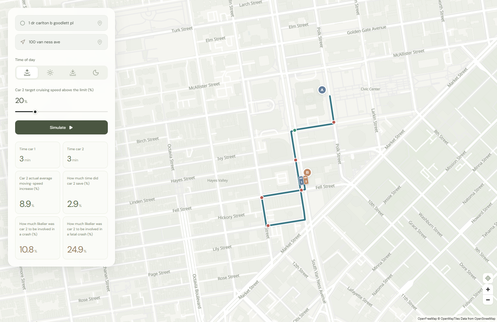

# Useless Speed

**How much time does speeding actually save in a city full of traffic lights?**

Useless Speed combines an interactive San Francisco driving experiment with a reusable collection of signal records, street geometry, traffic observations and transportation studies. You can run the app, explore the evidence, or use the data and code to build a different project.

The app sends two independent cars along the same route: one targets the modeled speed limit, and the other targets up to 100% above it. It plays their trips at 60× speed and compares travel times, achieved moving speeds and illustrative crash-risk indices.



**The name is a question to investigate, not a finding.** This is an exploratory model. Most signal phases and offsets are assumed, and the corpus does not establish current operating plans for every intersection. The risk percentages are illustrative population-based indices, not measured probabilities for an individual trip. Read the [model assumptions](app/README.md#model) before treating simulation results as evidence.

## Choose a starting point

| I want to… | Start here |
|---|---|
| Run the driving experiment | [Run the app](#run-the-app) |
| See what we collected | Open [the searchable offline catalog](corpus/index.html) locally |
| Use a small map dataset immediately | [Prepared app datasets](#prepared-datasets) and [Python examples](examples/README.md) |
| Analyze historical speeds | [Historical speed example](examples/hourly_speeds.py) |
| Find signal timings and original pages | [Checked cards](corpus/derived/verified_timing_cards.json), [candidate pages](corpus/derived/timing_pages.csv), [full-text search](#search-the-evidence) |
| Understand columns, units and joins | [Data dictionary](docs/data-dictionary.md) |
| Reproduce extraction or collect newer records | [Reproduction guide](docs/reproducing.md) |
| Host the app on Railway | [Deployment guide](docs/deployment.md) |
| Publish this folder to GitHub | [Sharing guide](docs/sharing.md) |

## Run the app

Use **Node.js 24** and npm. Python and the large research files are optional; all data needed by the app is included in ordinary Git files.

From the repository root:

```sh
npm ci
npm run dev
```

Open **http://127.0.0.1:5481**. The development UI runs on port 5481 and the Node API on port 8788. Both default to localhost. Pick two addresses or drop pins, choose a time of day, set the target speed increase, and select **Simulate**. The same button pauses and resumes. The timers show elapsed simulated time rounded to the nearest minute; calculations retain their full precision.

To serve a production build locally:

```sh
npm run build
npm start
```

Open **http://127.0.0.1:8788**. Stop the development server first to free port 8788.

Search accepts street addresses and place names such as Ferry Building, Dolores Park and Tartine Bakery. It uses the bundled SF address directory, official landmarks and 14,305 OpenStreetMap places, with no per-search external request. The selected time of day also changes the map and sidebar palette: warm morning, cool midday, soft evening and dark night.

New routes use the external OSRM service, and map tiles come from OpenFreeMap. Those operations require internet access; previously cached routes and the local street-map fallback provide partial offline support. No map API key is required for the current configuration.

## Get the full research collection

The selected originals total **2.14 GB across 223 source records**, representing **160 distinct file contents / 1.51 GB after byte-level deduplication**. Extracted data adds about 352 MB. A full checkout needs additional space for Git/LFS objects. Duplicates remain at their original paths so provenance links keep working.

Large research files use [Git Large File Storage](https://docs.github.com/en/repositories/working-with-files/managing-large-files/about-git-large-file-storage). Install Git LFS, then run:

```sh
git lfs install
git clone https://github.com/dhruv575/useless-speed.git
cd useless-speed
git lfs pull
python tools/verify_snapshot.py
```

Python **3.11+** is sufficient for verification and the examples; no Python packages are needed for those tasks. A successful verification means that the files match this recorded snapshot, not that their engineering content is current or correct.

For a smaller checkout containing the runnable app, catalog and checked subset, skip the large downloads:

```sh
# macOS / Linux / Git Bash
GIT_LFS_SKIP_SMUDGE=1 git clone https://github.com/dhruv575/useless-speed.git
```

```powershell
# PowerShell
$env:GIT_LFS_SKIP_SMUDGE = '1'
git clone https://github.com/dhruv575/useless-speed.git
Remove-Item Env:GIT_LFS_SKIP_SMUDGE
```

Later, use `git lfs pull` for everything or `git lfs pull --include="corpus/derived/corpus.sqlite"` for just the full-text index. Run `python tools/verify_snapshot.py --available` to verify a partial checkout. The catalog's **Public source** links work without local originals; **Open local file** links require the corresponding LFS data. GitHub's browser preview does not execute the catalog HTML; download it and open it locally. A GitHub ZIP may contain LFS pointers instead of actual research files, so a Git/LFS clone is the reliable option.

## What is included

This snapshot was collected on **October 10, 2026, America/Los_Angeles**. Retrieval timestamps use UTC, so many say October 11. Observation dates, document revision dates and collection dates are different things.

| Collection | Coverage in this snapshot | Main use |
|---|---|---|
| Original technical records | 160 unique files; 12,934 PDF pages, plus spreadsheets, CAD, Synchro/SimTraffic and archives | Source evidence and engineering context |
| Timing-page index | 760 candidate pages; 460 with labeled timing/card evidence | Find promising pages; values still need review |
| Checked timing subset | Four documents covering three intersections | Dated, limited manual transcription with source pages and caveats |
| SFCTA hourly speeds | 1,571,371 segment/month/hour records, Jan 2019–Sep 2026 | Historical speed patterns |
| SFCTA peak-period speeds | 132,940 segment/month/period records, Jan 2019–Sep 2026 | AM/PM context; this is the monthly dashboard despite the endpoint name |
| Historical CMP observations | Tables spanning 1991–2025, with changing segment systems | Long-term corridor comparisons with coverage checks |
| SFMTA signal inventory | 1,507 raw features | Signal locations, types and system metadata |
| SFMTA speed limits | 16,083 raw features | Posted-limit context, including sentinel and incomplete records |
| Street context | 15,444 lane features; 3,810 one-way features; green-wave layers | Mapping, route matching and network context |
| Traffic counts | 1,189 intersection rows and 8,099 corridor rows | Count context; interpret fields using source metadata |
| Simulator supplements | 224,402 address records and 11,179 stop-sign features | Local address search and stop matching |

The original 223-record catalog predates the simulator supplements. Address and stop-sign data are therefore documented in [supplemental provenance](corpus/metadata/app-supplements.json), the app's provenance/schema files and the repository-wide snapshot manifest, rather than counted as additional original catalog records.

See [collection notes](corpus/README.md) for the full dataset table, discovery method, missing downloads, and coverage limits. The bundle retains selected cataloged originals; unrelated exploratory downloads, local environments, runtime caches and browser response-body captures are omitted.

## Repository layout

```text
useless-speed/
├── README.md                   # Start here
├── package.json                # One npm workspace; root commands run the app
├── Dockerfile                  # Small production image; excludes research corpus
├── app/
│   ├── src/                    # React interface, map style and simulation engine
│   ├── src/model/              # Geometry, preparation, simulation, live metrics, worker
│   ├── server.mjs              # Address lookup, routing cache and static-file server
│   ├── public/data/            # Compact GeoJSON snapshots served to the browser
│   ├── data/                   # Server-side address directory, route fixture, schemas
│   └── README.md               # Detailed app and model documentation
├── corpus/
│   ├── index.html              # Offline, self-contained searchable catalog
│   ├── raw/                    # Original selected sources, organized by provider [LFS]
│   ├── derived/                # Catalogs, timing candidates, checked cards and extracts
│   │   ├── corpus.sqlite       # SQLite FTS5 search index [LFS]
│   │   ├── tables/             # UTF-8 CSV exports [LFS]
│   │   ├── pages/              # Per-file extraction results [LFS]
│   │   ├── text/               # Searchable text by content hash [LFS]
│   │   ├── workbooks/          # Cell formulas and cached values [LFS]
│   │   └── ocr/                # Local OCR blocks and confidence values [LFS]
│   ├── metadata/               # Source discovery, manifests, schemas and failures
│   ├── scripts/                # Collection, extraction and catalog generation
│   ├── requirements.txt        # Original Python collection environment pins
│   └── snapshot-manifest.json  # Paths, sizes and SHA-256 for bundled data artifacts
├── examples/                   # Runnable, independent data-use examples
├── tools/                      # Snapshot validation
├── docs/                       # Data dictionary, reproduction, sharing and hosting
├── CONTRIBUTING.md
├── DATA_LICENSES.md
└── CITATION.cff
```

**Path convention:** `local_path`, `text_path` and `workbook_path` inside the corpus catalogs are relative to `corpus/`, not the repository root. This keeps the original catalog and offline links intact. Paths in `snapshot-manifest.json` are explicitly relative to the repository root.

Long original download filenames were shortened for portable checkouts. Full titles remain in the catalog, original bytes/hashes are unchanged, and [path aliases](corpus/metadata/path-aliases.json) map the collection workspace's names to the public names.

## Prepared datasets

These files are convenient for small prototypes and do not require Git LFS:

Place-name search uses `app/data/places.json`: 14,305 named OpenStreetMap destinations in the supported SF bounds, including businesses, parks and attractions. Each record has an OSM ID, label, longitude/latitude coordinates, category, optional street address and aliases. `app/data/places-provenance.json` retains the query, source timestamp and ODbL attribution. This is a community-maintained snapshot, not an exhaustive or live business directory. Area features use representative centers; the router snaps these to drivable streets. Official addresses and landmarks remain a separate source.

| File under `app/public/data/` | Features | Preparation |
|---|---:|---|
| `signals.json` | 1,305 | Selected traffic-signal types; excludes pending signals and beacons |
| `speed-limits.json` | 3,754 | Numeric limits between 10 and 65 mph; excludes 0/99 sentinels |
| `stop-signs.json` | 11,179 | Supplemental SFMTA stop-sign layer snapshot |
| `streets.json` | 15,444 | Lane/street geometry with a reduced property set |
| `observed-speeds.json` | 693 | September 2026 hourly speeds joined to SFCTA expanded segments |
| `provenance.json` | — | Preparation time, source URLs, coverage counts and notes |

These are GeoJSON FeatureCollections despite the `.json` extension. Coordinates use **WGS84 longitude, latitude**. Speeds are **mph**; signal durations are **seconds**. A smaller prepared dataset is not a completeness claim. In particular, filtering signal *types* does not establish present-day controller operation.

Try these examples:

```sh
python examples/inspect_corpus.py
python examples/compact_map.py --output outputs/signals.geojson
python examples/compact_map.py --dataset observed-speeds --hour 17 --output outputs/evening.geojson
python examples/hourly_speeds.py --month 2026-09 --hour 17
```

The last command uses the full research data. The others use small bundled files. Exported GeoJSON can be opened in QGIS or loaded into another mapping application. [Example details](examples/README.md)

## Search the evidence

The offline catalog searches titles, scenario cues and timing excerpts. For complete extracted PDF and workbook text, fetch the SQLite index and run:

```sh
git lfs pull --include="corpus/derived/corpus.sqlite"
python corpus/scripts/query.py 'Synchro AND Existing' --limit 10
python corpus/scripts/query.py '"Ocean Avenue"' --json
```

The index has a `documents` table and an FTS5 `pages` table. `pages.document_id` joins to `documents.id`. `page` is a **one-based PDF page** or workbook sheet sequence, not necessarily the page number printed on the document. `documents.path` is relative to `corpus/`. Byte-identical documents retain provenance entries, but their text is indexed once.

For timing extraction, begin with `derived/verified_timing_cards.json`. Join `document_id` to `derived/catalog.json[].id`, then inspect the original `pdf_page`. The machine candidate fields are deliberately named `*_candidates`: do not assume a number belongs to a current controller without checking its intersection, movement, scenario, date, mode and offset reference.

## Build your own project

- **Create a signal map:** use `signals.json` and `streets.json`, then attach checked timing evidence through documented identifiers or reviewed spatial matches.
- **Study congestion by hour:** join SFCTA speeds to geometry on `cmp_segid` within the matching expanded segment system. Keep direction and source month. Do not combine aggregates with their underlying rows as independent observations.
- **Build a document-search tool:** use the SQLite index and retain original URLs, hashes and page numbers alongside every result.
- **Develop a more realistic traffic model:** reuse the corpus and map interface, then supply validated phase plans, queues, turning demand and vehicle interactions. The current engine does not provide these.
- **Adapt the experiment to another city:** replace the address source, geometry, routing bounds, posted limits, controls and observed speeds. Replace the hardcoded SF historical timing-card substitutions in `app/src/model/prepare.ts`; changing the map center alone is insufficient.

The browser worker receives a prepared route and compares two car runs. `prepare.ts` matches route geometry to inputs; `simulation.ts` computes trajectories; `live.ts` computes the metrics visible during playback. UI components are separate from these modules, so the model can be imported into another TypeScript project or replaced behind the worker interface. See the [app documentation](app/README.md) for formulas, units, matching rules and limitations.

## Validation and reproducibility

```sh
npm test
npm run build
python tools/verify_snapshot.py
```

The model tests cover equal-speed comparisons, time accounting, stop dwell, red-light crossing checks under the assumed model, and live metrics. Snapshot checks validate bytes and catalog consistency. Optional headless browser checks cover interaction and layout. These are software and data-integrity checks, not validation against real trips.

The [reproduction guide](docs/reproducing.md) explains Python/browser setup, extraction order, fresh discovery, supplemental data preparation and how to keep the dated snapshot intact. Re-downloading an endpoint today may not reproduce the archived bytes.

## Evidence limits

We have not established a comprehensive, current, movement-specific SF signal-cycle/offset database or a live SPaT feed. Checked timing cards are historical, and other reports often contain proposed or modeled scenarios. FREE and FLASH are operating modes, not fixed cycles; blank offsets are not zero. Fifteen primary-card pages received local OCR; 1,639 other sparse-text PDF pages did not. Native CAD/model files require appropriate software and have not been executed here.

The hourly speed tables contain aggregate observations, not vehicle trajectories or second-by-second signal states. A field named `year` in the monthly peak-period table is anomalously 2020 across this snapshot; use its `date` field. The simulation's risk equations do not yield personal crash probabilities or establish that a particular trip becomes a given percentage more dangerous.

## Attribution, reuse and contributions

Original project code and documentation are available under the [MIT license](LICENSE). **Third-party records, datasets, map styles and dependencies retain their own rights and terms**; MIT does not relicense them. Consult [DATA_LICENSES.md](DATA_LICENSES.md), keep source attribution, and cite the originating records as well as this compilation. Citation metadata is in [CITATION.cff](CITATION.cff).

Corrections and additional evidence are welcome. See [CONTRIBUTING.md](CONTRIBUTING.md) for provenance requirements and how to distinguish reviewed facts from model assumptions.
